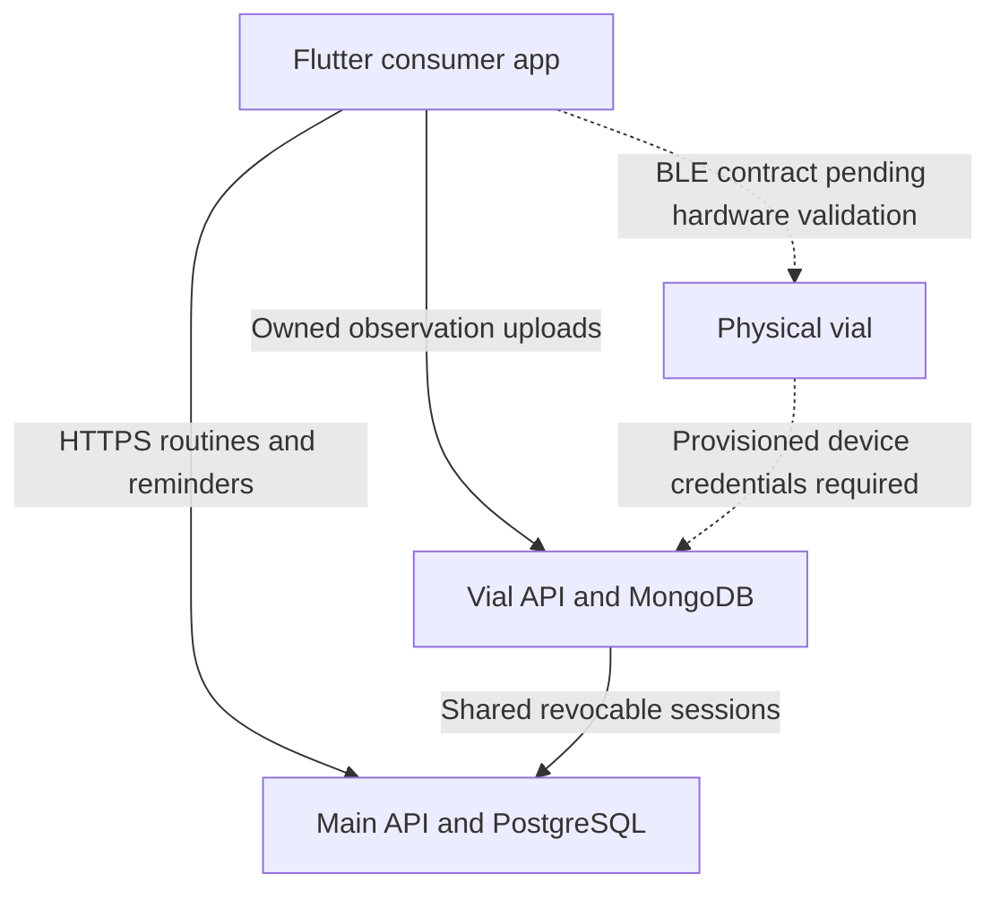

# Farda — Smart Vial Medication-Adherence Platform

Farda is a connected medication-adherence system: a **Bluetooth "smart pill bottle"** with a
load-cell scale and solenoid lock that logs dose/tamper events, a **Flutter mobile app** for
patients and caregivers, and **two backend services** that handle identity, prescriptions/OCR,
and device-event ingestion.

> **Status: consumer software review build.** The navy app, manual routines,
> refill planning, reminder foundations, and trust-boundary fixes are under active
> integration. Start with the [build handoff](reviews/OVERNIGHT_BUILD_HANDOFF.md)
> for verification and remaining device/provider gates. Earlier reviews describe
> the delivered baseline; they are not the current implementation status.

## Repository layout

| Path | Component | Stack | Role |
|------|-----------|-------|------|
| [`farda-app/`](farda-app/) | Mobile client | Flutter / Dart, Provider, `flutter_blue_plus` | Patient + caregiver app; phone-OTP login, prescription OCR capture, dose calendar, mood logging, BLE vial pairing |
| [`farda-app-backend/`](farda-app-backend/) | Main API | Express 5, Prisma + PostgreSQL, better-auth, Twilio Verify, OpenAI (OCR), Stripe | Auth, users, prescriptions, OCR → dose scheduling |
| [`smart-vial-backend/`](smart-vial-backend/) | Vial API | Express 5, Mongoose + MongoDB, better-auth (shared Postgres) | IoT device ingestion, events, device claiming, caregiver monitoring |
| [`firmware/`](firmware/) | Device firmware | ESP-IDF v5.4.1 / ESP32-WROOM-32D | `Smart_Pill_Bottle` image + BLE protocol + flashing/feature docs |
| [`reviews/`](reviews/) | Documentation | — | Enterprise code review, front-end review, firmware audit |

## Architecture (high level)



The two backends **share a single PostgreSQL / better-auth identity store**; domain data is split
across PostgreSQL (prescriptions/doses) and MongoDB (devices/events). See
[`reviews/FARDA_ENTERPRISE_CODE_REVIEW.md`](reviews/FARDA_ENTERPRISE_CODE_REVIEW.md) for the full
architecture map and known integration gaps.

## Consumer design handoff

The [Farda Figma handoff](prototypes/consumer-v2/FIGMA_HANDOFF.md) contains the
17-screen navy consumer design, prototype links, screen/node map, and verified
design-to-code results. The matching Flutter experience now lives in
`farda-app/lib/consumer_v2/` and is mounted at `/consumer/v2`, alongside the
API-backed consumer flow at `/dashboard`. See the
[frontend handoff](prototypes/consumer-v2/FRONTEND_HANDOFF.md) for what is
complete, the behavioral invariants, and the backend/native work that remains.

The [consumer upgrade plan](reviews/CONSUMER_UPGRADE_PLAN.md) maps every baseline
gap to the intended behavior. The [build handoff](reviews/OVERNIGHT_BUILD_HANDOFF.md)
maps those improvements to code, review commands, tests, and release gates.

## Getting started

Each component has its own README and dependencies. Secrets are provided via environment files —
copy the `.env.example` in each component to the real filename and fill in values.
**Real `.env` files are gitignored and must never be committed.**

```bash
# Main API
cd farda-app-backend && cp .env.example .env   # fill in values
pnpm install && pnpm prisma generate && pnpm dev

# Vial API
cd smart-vial-backend && cp .env.example .env  # fill in values
pnpm install && pnpm dev

# Mobile app
cd farda-app && cp .env.example .env.development
flutter pub get && flutter run
```

## Security notice

The original delivery committed live third-party credentials (Twilio, OpenAI, Stripe, MongoDB
Atlas). **Those have been stripped from this repository** and replaced with `.env.example`
placeholders. If the originals were ever pushed elsewhere, **rotate all of those credentials.**
Outstanding security findings (unauthenticated PHI endpoints, IDOR, device-spoofing, cleartext
auth key in firmware, etc.) are catalogued in [`reviews/`](reviews/).
